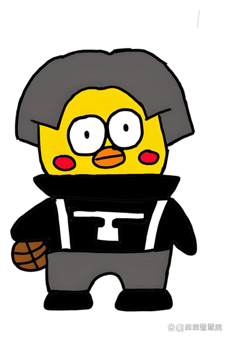

# 桌宠 · dsh-desktop-pet

给 **DeepSeek Harness** Web 界面加一只住在右下角的小宠物：它跟着 Agent 的状态换动作，任务完成时叫一声「你干嘛」。

> A tiny desktop pet for the DeepSeek Harness Web UI. It idles, bounces while the agent works, and celebrates with a voice line when a task finishes.



## 它什么时候做什么

| 状态 | 触发条件 | 表现 |
|---|---|---|
| 待机 `idle` | 没有会话在跑 | 轻轻呼吸起伏，影子同步缩放 |
| 思考中 `working` | 任意会话 `running === true` | 上下弹跳 + 轻微摇摆，头顶气泡「思考中…」和跳动的小点 |
| 完成 `done` | 从运行中变为空闲（当前这次任务结束） | 连跳五下 + 气泡「搞定啦！」，同时播放「你干嘛」语音 |

- **点一下宠物**：随时播放语音并冒出「你干嘛！」气泡；如果浏览器拦了自动播放，点一下就会恢复。
- **鼠标移到宠物上**：右上角出现 `×`，点掉可以收起（刷新页面后回来）。
- 跟随 `prefers-reduced-motion`：系统开启「减少动态效果」时不动画，只保留状态与声音。
- 不占端口、不开服务、不发额外网络请求：图与语音都内联在浏览器模块里。

## 安装

需要 DSH Desktop（或带 Web 界面的 `dsh` profile），Node 22+。

```powershell
# 1) 安装（本地目录）
dsh plugin --profile desktop add "link:<本仓库路径>"

# 或者直接从 GitHub 安装（需要先构建出 client.js，本仓库已包含构建产物）
dsh plugin --profile desktop add "github:<owner>/dsh-desktop-pet"

# 2) 重启一次 DSH（bundle 层在启动时组装）
```

装好后右下角就会出现桌宠；第一次在页面里点一下，之后语音才不会被自动播放策略拦。

卸载：

```powershell
dsh plugin --profile desktop remove dsh-desktop-pet
```

## 结构

```
dsh-desktop-pet/
├── package.json          # dsh.bundle + dsh.client(platform: web)
├── cordis.patch.yml      # 插入一行 Host 插件（id: desktop-pet）
├── index.js              # Host 半边：空实现，不占端口、不开服务
├── client.js             # 浏览器半边（构建产物，图与语音已内联）
├── client.src.js         # 可读源码，占位符由 tools/build-client.mjs 替换
├── locale/{zh,en}.json   # 插件管理里显示的名称与描述
├── icon.png              # 插件图标
├── assets/pet.png        # 抠掉白底的角色图（384×566，透明 PNG）
├── assets/voice.mp3      # 「你干嘛」语音
└── tools/
    ├── cutout.py         # 原图 → 透明 PNG + 图标
    ├── build-client.mjs  # 把图与语音内联成 client.js
    └── smoke.mjs         # 无浏览器冒烟测试
```

改完 `client.src.js` 或换素材后重新构建：

```bash
node tools/build-client.mjs
node tools/smoke.mjs
```

## 实现要点

- 渲染进 `shell.overlay` 槽（列表 slot，root 作用域），不往 `document.body` 追加第二个应用，也不读写宿主 DOM。
- 状态来自 `ui-session` 提供的标准 `useSessions` 选择器：遍历 `byId`，任一 `running` 即为工作中；`running` 由真变假的那一次渲染即「任务完成」。
- 图与音频以 base64 内联在 `client.js`，因此不需要 Host 路由、静态文件服务或额外网络请求，`dsh web` 与 Desktop 行为一致。
- 所有副作用（计时器、音频）都在 `useEffect` 内建立并在卸载时清理；模块卸载时插槽贡献自动撤销。

## 许可与素材

代码以 MIT 许可发布，见 [LICENSE](./LICENSE)。

- `assets/pet.png` 由仓库作者的原始插图 `037e5c03a40ca3b190714faeb5a07c79.jpg` 经 `tools/cutout.py` 自动抠白底生成；
- `assets/voice.mp3`（「你干嘛」）由仓库作者提供。

两张素材随代码一同以 MIT 发布；如果你要再分发，请保留本节的来源说明。
